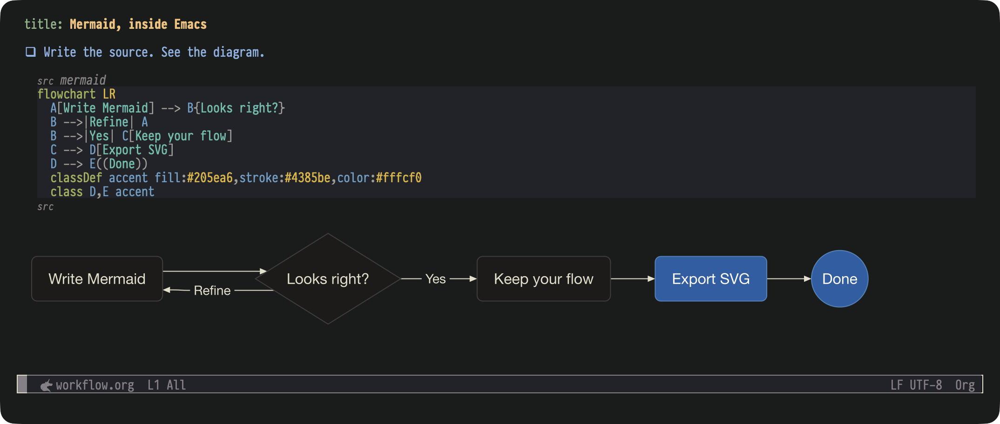
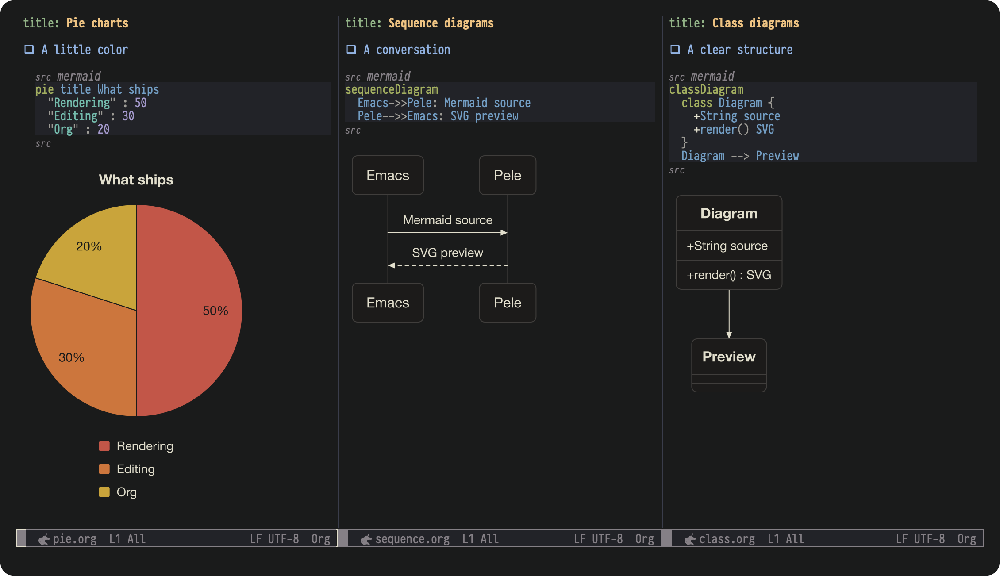

# pele.el

Edit Mermaid and render SVG diagrams in Emacs with the original [Pele](https://github.com/obsidianmd/pele) engine maintained by kepano / Obsidian.



- Edit Mermaid with the official website's highlighting rules, implemented in pure Elisp.
- Preview diagrams live in Org and Markdown, or in a separate window from any buffer.
- Export SVG directly or through Org Babel.
- Render locally in a background worker, with no Mermaid CLI, Node.js or browser required.

## Diagram gallery

Render flowcharts, sequence and class diagrams, ER diagrams, Gantt charts, mindmaps, pie charts and more. Here are three examples with their source and live Org previews:



Screenshots use Ashen Night, PragmataPro and Org Modern, with an opaque Emacs window background.

## Installation

Build from source on macOS or Linux. Editing and highlighting can also be used on their own, without building the renderer.

Requirements:

- Emacs 29.1+ with dynamic module support; SVG image support for previews.
- A C compiler with pthreads, Make, Python 3.10+ and `emacs-module.h` from your Emacs installation.
- Recommended: `pkg-config` and Pango 1.44+ development files (`pangocairo`) for accurate font measurements. Without Pango, the renderer uses Pele's built-in width estimates.

Install the optional font backend with `brew install pkg-config pango` on Homebrew, or `apt install pkg-config libpango1.0-dev` on Debian/Ubuntu. Then:

```sh
git clone https://github.com/LuciusChen/pele.el.git ~/repos/pele.el
cd ~/repos/pele.el
make -j4
```

If Emacs or its header is elsewhere, use `make EMACS=/path/to/emacs EMACS_INCLUDE=/path/to/include`. Keep the resulting `pele-native.dylib` (macOS) or `pele-native.so` (Linux) alongside `pele.el`.

Add to your Emacs configuration:

```elisp
(add-to-list 'load-path (expand-file-name "~/repos/pele.el"))
(require 'pele)
(add-hook 'org-mode-hook #'pele-org-mode)
```

For editing and highlighting alone, require `pele-mode` instead. Loading the Lisp files does not load the native renderer until the first render.

## Usage

### Source files and regions

Open a `.mmd` or `.mermaid` file to enter `pele-mode`. Use `C-c C-p` to preview or `C-c C-e` to export SVG. In other buffers, select a region of Mermaid source and run `M-x pele-preview` or `M-x pele-export`. With no region, these commands use the Org or Markdown code block at point, or the whole diagram buffer.

In a preview, `g` renders again, `s` saves SVG and `q` quits. Customize `pele-indent-offset` (default 2) and the `pele-highlighting` face group to adjust source editing.

### Org

In Org, `pele-org-mode` shows previews below both `mermaid` and `pele` blocks:

```org
#+begin_src mermaid
flowchart LR
  Edit --> Preview --> Export
#+end_src
```

Previews are overlays and do not modify the file. Edits refresh after 0.2 idle seconds by default. Incomplete input keeps the last successful image; the preview's help text reports the error. Try [examples/gallery.org](examples/gallery.org) and [examples/editor.org](examples/editor.org).

Both block languages use `pele-mode` for native source highlighting and `C-c '` editing, unless you have explicitly chosen another source mode. Keep `org-src-fontify-natively` enabled.

### Org Babel

```elisp
(require 'ob-pele)
```

```org
#+begin_src pele :file diagram.svg :results file graphics
sequenceDiagram
  Alice->>Bob: Hello
  Bob-->>Alice: Hi
#+end_src
```

`:file` is required and must end in `.svg`. Optional `:width` and `:font-size` use pixels. Org's normal Babel execution and confirmation settings apply.

To handle existing `mermaid` Babel blocks, call `(pele-babel-enable-mermaid)` explicitly. If using `ob-mermaid`, load it first. `(pele-babel-disable-mermaid)` restores the execution function saved when the override was enabled. Requiring `ob-pele` alone leaves other Babel backends in place.

### Markdown

Enable `pele-markdown-mode` in a Markdown buffer, or add hooks:

```elisp
(require 'pele-markdown)
(add-hook 'markdown-mode-hook #'pele-markdown-mode)
(add-hook 'markdown-ts-mode-hook #'pele-markdown-mode)
```

Mermaid fenced code blocks show live SVG previews below the closing fence. This works with `markdown-mode`, `gfm-mode` and `markdown-ts-mode`. Both backtick and tilde fences are supported, with `mermaid` or `pele` as the language. The Markdown major mode continues to handle editing and fenced-code highlighting.

Edits refresh after `pele-preview-delay`, retaining the last successful diagram while the source is incomplete. Disabling the mode, deleting a block, changing major modes or killing the buffer cancels its pending work and removes previews. The Markdown file is unchanged. With point inside a Mermaid fence, `pele-preview` and `pele-export` also work without enabling live previews. Try [examples/gallery.md](examples/gallery.md).

## Appearance and render options

```elisp
(setq pele-theme 'auto
      pele-background 'transparent
      pele-text-measurement 'native)
```

The default transparent canvas lets the Emacs buffer show through; boxes, circles and other nodes retain their fills. Set `pele-background` to `theme` for a solid canvas, for example when exporting onto a different background.

`pele-theme` accepts `auto` (Emacs foreground/background plus Pele's palette), `pele` (the full official light/dark palette), `light`, `dark`, or an alist of CSS variables such as `(("--pele-bg" . "#202124") ("--pele-fg" . "#eeeeee"))`.

Other user options include `pele-font-size`, `pele-font-family`, `pele-font-family-mono`, `pele-preview-delay`, `pele-render-timeout`, `pele-cache-size` and `pele-cache-byte-limit`. Font measurements use Pango when available, including bold, italic and monospace labels. Browser and Emacs SVG display can still differ slightly.

## Lisp API

```elisp
(pele-render "flowchart LR\nA --> B" '(:theme dark :max-width 800))
;; => (:ok t :svg "<svg ...>" :width ... :height ... :type "flowchart" ...)

(let ((id (pele-render-async
           "flowchart LR\nA --> B"
           (lambda (result)
             (if (plist-get result :ok)
                 (message "Rendered %s" (plist-get result :type))
               (message "%s" (plist-get (plist-get result :error) :message)))))))
  ;; Retain ID; call (pele-cancel id) when the result is no longer needed.
  id)
```

Async callbacks run later on the Emacs thread, including cache hits. Cancellation suppresses the callback. `pele-render` waits and signals `pele-error` on failure, carrying a message and error plist. Interactive previews use the async API.

Both functions accept an options plist:

| Options | Meaning |
| --- | --- |
| `:font-size`, `:font-family`, `:font-family-mono` | Label size in pixels and font families |
| `:measure-text` | `native` (Pango if built in) or `estimate` (upstream width table) |
| `:theme`, `:background` | Same values as the corresponding user options |
| `:max-width`, `:auto-direction` | Width constraint; opt in to choosing direction instead of preserving the source direction |
| `:timeout` | Render deadline in milliseconds, from 1 to 60,000; default 1,000 |
| `:now` | Epoch milliseconds for deterministic Gantt output |
| `:config` | JSON-compatible alist or hash table of Mermaid configuration defaults |

Configuration in the diagram source takes precedence over `:config`. Gantt results using the current date are not cached; supply a numeric `:now` to cache them. Successful results otherwise use an LRU cache bounded by 32 diagrams and 16 MiB of SVG data by default.

`M-x pele-clear-cache` discards cached results. `M-x pele-shutdown` cancels pending requests and releases the worker; the next render starts it again. Call it before reloading edited Lisp files. **Restart Emacs after rebuilding a loaded native module**: loading Lisp again cannot replace the native binary.

## Compatibility

Diagram syntax and layout follow **Pele**, including its differences from Mermaid.js. Syntax highlighting follows the official website's lexical rules; the renderer reports syntax errors and source locations when available.

External icon libraries and mathematical typesetters are not bundled, so Pele's text fallback applies. Images and clickable links in diagrams are disabled.

## Development

Run `make check` to compile with warnings as errors and run the editor, renderer and diagram corpus tests. See the [development guide](docs/DEVELOPMENT.md) for architecture, limits, reference updates and benchmarks.

Current dependency versions and source hashes are recorded in [vendor/README.md](vendor/README.md). Release notes are maintained in [CHANGELOG.md](CHANGELOG.md).

## License

Project code is licensed under the [MIT License](LICENSE). Pele, QuickJS, the website highlighter and the documentation examples retain their upstream MIT licenses and copyright notices. Preserve those notices when redistributing sources or bundled modules. See [vendor/README.md](vendor/README.md) and [test/corpus/SOURCE.md](test/corpus/SOURCE.md) for versions, hashes and attribution.
