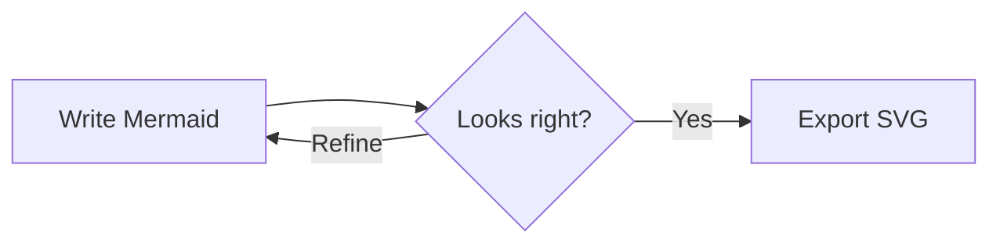
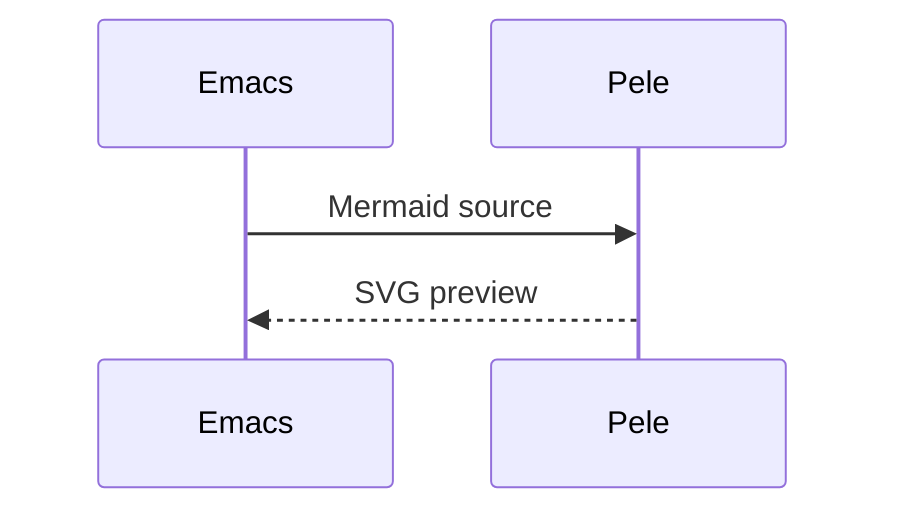

# Mermaid previews in Markdown

Enable `M-x pele-markdown-mode` to show live SVG previews below these blocks.
Edit a diagram and pause to refresh it. `M-x pele-preview` and `M-x pele-export`
also use the Mermaid block at point without enabling live previews.

## Flowchart

## Sequence

## Pie

~~~mermaid
pie title What ships
  "Rendering" : 50
  "Editing" : 30
  "Markdown" : 20
~~~
